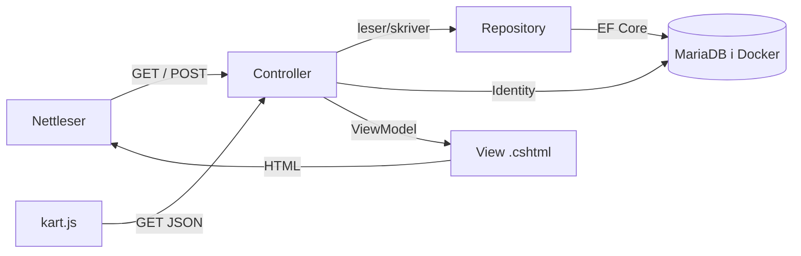

# Beredskapsportalen

En nettportal for krisesituasjoner der **offentlige aktører** (Heimevernet, kommuner) melder inn behov, og **private aktører** (bedrifter, entreprenører, privatpersoner) tilbyr ressurser som aggregater, drivstoff og transport. Behov og ressurser vises på et kart, slik at det blir lett å se hvor hjelpen trengs og hva som finnes i nærheten.

Prosjektet er laget som gruppeoppgave i IS-200 (Oppgave 1 og Oppgave 2) og er en **ASP.NET Core MVC-applikasjon som kjøres sammen med en MariaDB-database i Docker**.

## Gruppemedlemmer

- Thilo Moi
- Tobias K. Lindkvist
- Christian Urdal Hansen
- Ludvig Jensen
- Pelle Kvandal
- Emil Lund Storebaug

---

## Hurtigstart

**Krever:** [Docker Desktop](https://www.docker.com/products/docker-desktop/)

```bash
git clone https://github.com/thilomoi05/Prosjekt_host_1.git
cd Prosjekt_host_1
cp .env.example .env      # sett egne passord i .env før du starter
docker compose up --build
```

Se [docs/drift.md](docs/drift.md) for hva som må stå i `.env`.

Åpne **http://localhost:8080** og logg inn med en av testbrukerne:

| Brukernavn | Passord | Rolle | Hva du ser |
|---|---|---|---|
| `test` | `Beredt2026` | Offentlig aktør (f.eks. Heimevernet) | Oversikt, kart, behov, ressurser og hva som trengs |
| `privat` | `Beredt2026` | Privat aktør (bedrift eller privatperson) | Egne ressurser, tilby ressurs og hva som trengs |
| `admin` | `Beredt2026` | Administrator (har også rollen offentlig aktør) | Alt en offentlig aktør ser, pluss adminsiden for godkjenning og tildeling |

Passordet kommer fra `TESTBRUKER_PASSORD` i `.env`. Se [Testbrukere i docs/drift.md](docs/drift.md#testbrukere).

Mer om kjøring, begrensninger og feilsøking: **[docs/drift.md](docs/drift.md)**

---

## Funksjoner

Tre roller, med tilgang sjekket på serveren (`[Authorize(Roles = ...)]`):

| Rolle | Kan |
|---|---|
| **Offentlig aktør** (kommune, sykehus, Heimevernet) | Melde behov med type, prioritet og plassering · se alle behov med filter · se kart med behov og ressurser · finne og forespørre ressurser til egne behov · trekke tilbake egne behov |
| **Privat aktør** (bedrift, privatperson) | Tilby ressurser med bilder · se status på egne ressurser (venter, godkjent, avvist, tildelt) · **endre** og trekke tilbake egne ressurser · se «Hva trengs» uten å se hvem som har meldt |
| **Admin** | Godkjenne eller avvise ressurser og offentlige aktører · tildele ressurser til behov med forslag sortert på avstand · godkjenne eller avslå forespørsler · fjerne tildelinger · endre alle ressurser |

I tillegg:

- **Registrering og innlogging** med ASP.NET Core Identity. Offentlige aktører må godkjennes av admin før de kan logge inn.
- **Kart** (Leaflet + Kartverket) med egne ikoner per type og farge per prioritet. Skjemaene har en posisjonsvelger: klikk i kartet eller søk opp en adresse.
- **Oversikt** over ressurser og behov: dashbord, liste med filter under kartet, detaljsider og oversikt over tildelinger.
- **Historikk:** alt som skjer med et behov eller en ressurs (sendt inn, godkjent, endret, tildelt, trukket tilbake) lagres og vises på detaljsiden.
- **Mobiltilpasset:** responsivt design med Bootstrap og egne `@media`-regler.

## Teknologi

| Område | Teknologi |
|---|---|
| Rammeverk | ASP.NET Core MVC, .NET 10 |
| Innlogging | ASP.NET Core Identity (passord-hash med PBKDF2 og salt, roller, utestenging) |
| Datalagring | MariaDB 11.4 med Entity Framework Core 10 (Microting.EntityFrameworkCore.MySql) og migrations |
| Kart | [Leaflet](https://leafletjs.com/) med kartfliser fra Kartverket |
| Adressesøk | Geonorge sitt adresse-API (`ws.geonorge.no/adresser/v1`) |
| Testing | xUnit og NSubstitute |
| Drift | Docker Compose (to containere: `web` og `db`) |

---

## Arkitektur

Applikasjonen følger **MVC-mønsteret** (Model–View–Controller), med et eget **repository-lag** for datalagring. Controllerne kjenner bare repository-grensesnittene, derfor ble MariaDB lagt til uten å endre dem. 



Full beskrivelse av lagene, innlogging, kartet og alle endepunkter: **[docs/arkitektur.md](docs/arkitektur.md)**

### Prosjektstruktur

```
├── Controllers/        Home, Konto, Oversikt, Behov, Ressurs, Kart, HvaTrengs, Tildeling, Foresporsel, Admin
├── Data/               BeredskapsDbContext, oppstart av database og testbrukere
├── Migrations/         Tabellene i MariaDB, laget med EF Core migrations
├── Models/             Behov, Ressurs, Bruker, Tildeling, Foresporsel, Hendelse, Roller, Enums
│   └── ViewModeller/   Skjemamodeller med validering
├── Services/           Repository-grensesnitt, EF- og minnebaserte repositories, TildelingTjeneste
├── Sikkerhet/          Sikkerhetsheadere og norske feilmeldinger fra Identity
├── Views/              Én mappe per controller + Shared/_Layout
├── wwwroot/            CSS og JavaScript (kart, posisjonsvelger, skjemaer, filter)
├── Beredskapsportal.Tests/   Automatiske tester (xUnit)
├── docs/               drift.md, arkitektur.md, ki-bruk.md
├── docker-compose.yml  App og database
├── Dockerfile
└── Program.cs          Oppstart, DI, Identity, sikkerhet og ruting
```

### Sider og endepunkter

| Metode | Adresse | Beskrivelse | Tilgang |
|---|---|---|---|
| GET | `/` | Forside | Alle |
| GET / POST | `/Konto/Registrer` | Registrere bruker (offentlig eller privat aktør) | Alle |
| GET / POST | `/Konto/LoggInn` | Logge inn | Alle |
| POST | `/Konto/LoggUt` | Logge ut | Innlogget |
| GET | `/Konto/Profil` | Min side | Innlogget |
| GET | `/Oversikt` | Dashbord | Innlogget |
| GET | `/HvaTrengs` | Hva som trengs, uten hvem som har meldt | Innlogget |
| GET | `/Behov` | Alle behov med filter | Offentlig aktør |
| GET / POST | `/Behov/Registrer` | Melde behov | Offentlig aktør |
| GET | `/Behov/Detaljer/{id}` | Detaljside med historikk | Offentlig aktør |
| GET / POST | `/Behov/TrekkTilbake/{id}` | Trekke tilbake eget behov | Offentlig aktør (eier) |
| GET / POST | `/Ressurs/Registrer` | Tilby ressurs med bilder | Innlogget |
| GET | `/Ressurs/Detaljer/{id}` | Detaljside med bilder, kart og historikk | Eier, admin, eller offentlig aktør når godkjent |
| GET / POST | `/Ressurs/Rediger/{id}` | Endre ressurs | Eier og admin |
| GET / POST | `/Ressurs/TrekkTilbake/{id}` | Trekke tilbake (slette) ressurs | Eier og admin |
| GET | `/Ressurs/Bilde/{id}` | Bilde av ressurs | Samme som detaljsiden |
| GET | `/Kart` | Kart med liste og filter | Offentlig aktør |
| GET | `/Kart/Behov`, `/Kart/Ressurser` | Punkter som JSON til kartet | Offentlig aktør |
| GET | `/Foresporsel/FinnRessurs/{id}` | Forslag til ressurser for eget behov | Offentlig aktør |
| POST | `/Foresporsel/Foresporr` | Forespørre en ressurs | Offentlig aktør |
| GET | `/Tildeling` | Alle tildelinger med filter | Offentlig aktør |
| GET | `/Admin` | Godkjenning av ressurser, brukere og forespørsler | Admin |
| GET / POST | `/Admin/Tildel/{id}` | Tildele ressurser til et behov | Admin |
| POST | `/Admin/GodkjennRessurs`, `AvvisRessurs`, `GodkjennBruker`, `AvvisBruker`, `GodkjennForesporsel`, `AvslaForesporsel`, `FjernTildeling` | Handlinger på adminsiden | Admin |

**Flyt i et skjema (eksempel):** `GET /Behov/Registrer` viser skjemaet → brukeren sender det inn med `POST` → controlleren validerer og lagrer i MariaDB via repository → brukeren sendes videre til `/Behov`, der det nye behovet vises.

---

## Krav i Oppgave 1

| # | Krav | Hvor | Status |
|---|---|---|---|
| – | Kjøres i Docker | `Dockerfile`, [docs/drift.md](docs/drift.md) | Ferdig |
| 1 | Controller, view-modell og view | `Controllers/`, `Models/ViewModeller/`, `Views/` | Ferdig |
| 2 | Responsive sider med dynamisk innhold fra webserver | Razor-views, `site.css`, kartdata som JSON | Ferdig |
| 3 | Håndterer GET og POST | Se tabellen over endepunkter | Ferdig |
| 4 | Skjema, og data vises på en annen side | Behov: `/Behov/Registrer` → `/Behov` og `/Oversikt` | Ferdig |
| 5 | Kart, og data fra kartet vises på en annen side | Posisjonsvelger i skjemaene → punkter på `/Kart` | Ferdig |
| 6 | Dokumentasjon om drift, arkitektur og testing | [docs/drift.md](docs/drift.md), arkitektur og [testing](#testing) i denne README | Ferdig |
| 7 | Dokumentasjon i koden | Norske kommentarer og XML-summaries i koden | Ferdig |
| 8 | Bruk av KI | Se under | Ferdig |

## Krav i Oppgave 2

| # | Krav | Hvor i koden / dokumentasjonen | Status |
|---|---|---|---|
| 1 | Kobling mot MariaDB, app og database i Docker | `docker-compose.yml`, `Data/BeredskapsDbContext.cs`, `Migrations/`, `Services/Ef*Repository.cs`, [docs/drift.md](docs/drift.md) | Ferdig |
| 2 | Registrering av ny bruker, lagret i databasen | `Controllers/KontoController.cs`, `Models/Bruker.cs` (tabellen `AspNetUsers`) | Ferdig |
| 3 | Autentisering, autorisering, og legge til, endre og slette ressurs | `KontoController`, `[Authorize(Roles)]` på controllerne, `RessursController` (`Registrer`, `Rediger`, `TrekkTilbake`) | Ferdig |
| 4 | Funksjoner som beskrevet av oppdragsgiveren | [Funksjoner](#funksjoner), `Services/TildelingTjeneste.cs`, [docs/arkitektur.md](docs/arkitektur.md) avsnitt 1 og 5b | Ferdig |
| 5 | Kartet i skjemaet setter et punkt | `wwwroot/js/posisjonsvelger.js`, `Views/Behov/Registrer.cshtml`, `Views/Ressurs/Registrer.cshtml` | Ferdig |
| 6 | Mobiltilpasset frontend | `wwwroot/css/site.css` (`@media`), `_Layout.cshtml`, [mobiltest](#mobiltest) | Ferdig |
| 7 | Enkel oversikt over ressurser | `/Oversikt`, lista under kartet, `/Ressurs/Detaljer`, `/Tildeling` | Ferdig |
| 8 | Sikkerhetstiltak | `Program.cs`, `Sikkerhet/SikkerhetsheadereMiddleware.cs`, [docs/arkitektur.md](docs/arkitektur.md) avsnitt 6 | Ferdig |
| 9 | Testing (enhet, system, sikkerhet, brukervennlighet) | `Beredskapsportal.Tests/`, [Testing](#testing) | Se [Testing](#testing) |
| 10 | Dokumentasjon om drift, arkitektur og testing | [docs/drift.md](docs/drift.md), [docs/arkitektur.md](docs/arkitektur.md), [Testing](#testing) | Ferdig |
| 11 | Dokumentasjon i koden | `/// <summary>` på alle klasser, norske kommentarer i C#, Razor (`@* *@`) og JavaScript | Ferdig |
| 12 | Bruk av KI | [Bruk av KI](#bruk-av-ki), [docs/ki-bruk.md](docs/ki-bruk.md) | Ferdig |

---

## Testing

Vi har testet appen manuelt i nettleseren, med appen kjørende i Docker (se [Hurtigstart](#hurtigstart)).

**Testmiljø:** Windows, den innebygde nettleseren i VS Code, Docker Desktop · **Dato:** 30.09.2026 · **Testbruker:** `test` / `test`

✅ bestått · ⚠️ bestått med merknad

### Registrere bruker og logge inn/ut

| Scenario | Steg | Forventet resultat | Faktisk resultat |
|---|---|---|---|
| Registrere ny bruker | Gå til `/Konto/Registrer`, fyll ut alle felt og trykk «Registrer» | Brukeren logges inn og sendes til Oversikt | ✅ Logget inn og sendt til Oversikt. Navnet vises øverst til høyre |
| Logge ut | Trykk på navnet øverst til høyre | Brukeren sendes til forsiden, og menyen viser «Logg inn» | ✅ Som forventet |
| Logge inn | Logg inn med testbrukeren og med den nye brukeren | Brukeren sendes til Oversikt | ✅ Som forventet for begge brukerne |

### Feil passord og tomme felt (validering)

| Scenario | Steg | Forventet resultat | Faktisk resultat |
|---|---|---|---|
| Feil passord | Logg inn med riktig brukernavn og feil passord | Feilmelding, og brukeren blir på innloggingssiden | ✅ «Feil brukernavn eller passord.» |
| Tomt innloggingsskjema | Trykk «Logg inn» uten å fylle ut noe | Feilmelding ved hvert felt | ✅ «Du må skrive inn brukernavn.» og «Du må skrive inn passord.» |
| Tomt registreringsskjema | Trykk «Registrer» uten å fylle ut noe | Feilmelding ved hvert påkrevde felt | ✅ Feilmelding for alle fem feltene, øverst og under hvert felt |
| Ulike passord | Skriv to forskjellige passord ved registrering | Feilmelding | ✅ «Passordene er ikke like.» |
| Brukernavnet er tatt | Registrer en bruker med brukernavnet `test` | Feilmelding | ✅ «Brukernavnet er allerede i bruk.» |
| Tomt behovsskjema | Trykk «Registrer» på `/Behov/Registrer` uten å fylle ut noe | Feilmelding ved hvert påkrevde felt, også manglende posisjon | ⚠️ Alle feltene får feilmelding, men posisjonsmeldingen vises to ganger (se under) |

### Melde behov og registrere ressurs

| Scenario | Steg | Forventet resultat | Faktisk resultat |
|---|---|---|---|
| Melde behov | Fyll ut `/Behov/Registrer`, klikk i kartet og trykk «Registrer» | Brukeren sendes til `/Behov`, og det nye behovet står øverst | ✅ Behovet står øverst i listen med dagens dato |
| Registrere ressurs med posisjon | Fyll ut `/Ressurs/Registrer` med adresse, «Finn på kartet», bekreft plasseringen, legg ved bilde og trykk «Registrer» | Ressursen vises på `/Kart` på riktig sted | ✅ Grønn markør ved riktig adresse. Boblen viser adresse, tilgangsbeskrivelse, kontaktinfo og bildet |

### Docker

| Scenario | Steg | Forventet resultat | Faktisk resultat |
|---|---|---|---|
| Starte appen i Docker | Kjør kommandoene under [Hurtigstart](#hurtigstart) og åpne http://localhost:8080 | Appen starter, og forsiden vises | ✅ Appen starter, og alle testene over ble kjørt i Docker |

### Automatiske tester (xUnit)

I tillegg til de manuelle testene over har vi automatiske enhetstester i `Beredskapsportal.Tests/`. De kjører uten Docker og uten nettleser, og sjekker logikken i controllere, repositoryer og modeller direkte.

Kjør dem fra rotmappen med:

```bash
dotnet test Beredskapsportal.Tests
```

| Testfil | Hva den sjekker |
|---|---|
| `BehovRepositoryTester.cs` | Tellingene på forsiden og i Oversikt, og at nyeste behov vises først |
| `BrukerOgPassordTester.cs` | Passordhashing med salt, og oppslag på brukernavn uavhengig av store/små bokstaver |
| `ModellTester.cs` | Passordreglene i registreringsskjemaet og visningsnavn for behovstyper |
| `KontoControllerTester.cs` | Innlogging med riktig og feil passord, og opptatt brukernavn ved registrering |
| `BehovControllerTester.cs`, `ControllerTester.cs` | At gyldige behov lagres og ugyldige ikke, og tallene på forsiden |
| `RessursControllerTester.cs` | At ressurser må ha bilder av riktig filtype, og at `/Ressurs/Bilde` ikke kan hente filer utenfor bildemappen |

`TestHjelpere.cs` inneholder små erstatninger for innlogging og filsystem, slik at controllerne kan testes uten at appen kjører.

### Funnet under testing

| Feil | Hvor | Status |
|---|---|---|
| Meldingen «Du må klikke i kartet for å markere plasseringen.» vises to ganger øverst i skjemaet når posisjon mangler | `/Behov/Registrer`, `/Ressurs/Registrer` | Rettet: bare breddegraden sjekkes med `[Required]`, så meldingen vises én gang |

### Forbedringer vi vil gjøre

- **Adresse fra kartet:** Når brukeren klikker i kartet, skal adressen hentes ut fra koordinatene og fylles inn i adressefeltet automatisk (omvendt adressesøk). I dag går det bare motsatt vei: fra adresse til punkt på kartet.

---

## Bruk av KI

KI er brukt som støtte gjennom hele prosjektet, fra idé til kode. Alle endringer laget med KI har gått gjennom pull request og review fra gruppemedlemmer. Mer utfyllende beskrivelse: [docs/ki-bruk.md](docs/ki-bruk.md).

### Verktøy
- **Claude (Anthropic)**, i chat og som kodeagent (Claude Code): koding, feilsøking, skissering, testing, dokumentasjon og planlegging

### Bruksområder
| Fase | Hvordan KI ble brukt |
|---|---|
| Idé og design | Oversette Figma-skissen til sider og komponenter, designutkast for layout og farger |
| Koding (Oppgave 1) | Grunnstruktur (MVC, repositories, innlogging), kartfunksjon, posisjonsvelger |
| Koding (Oppgave 2) | ASP.NET Core Identity og roller, sikkerhetsheadere, godkjenning og tildeling, detaljsider og filter, «Endre ressurs» |
| Testing | Utkast til xUnit-tester og testscenarioer for systemtest og sikkerhetstest |
| Drift | Veiledning steg for steg for Dockerfile, `docker-compose.yml` og feilsøking |
| Dokumentasjon | Utkast til `docs/drift.md`, `docs/arkitektur.md` med diagrammer, og denne README-en |
| Planlegging | Oppsett av Trello-tavle, statusoversikt over kravene i oppgaven |

### Regler for KI i repoet
[AGENT.md](AGENT.md) beskriver hvordan KI-agenter skal jobbe: aldri kode direkte i `main`, alltid egen branch og pull request, og KI merger aldri sin egen PR. Commits laget med KI er merket med `Co-Authored-By: Claude`.

### Eksempler på prompter
- *«Bygg forsiden etter Figma-skissen, med innlogging og skjema for behov og ressurser»*
- *«Ta meg gjennom Docker-oppsettet steg for steg og forklar hva som skjer underveis»*
- *«Se gjennom repoet og sett opp en Trello-tavle med oppgavene som er gjort og det som gjenstår»*
- *«Gå i git-repoet og gi inspirasjon med figurer og diagrammer for hvordan arkitekturen er og hva vi skal gjøre videre. Vis hvordan jeg kan sette opp diagrammer i markdown-filer»*
- *«Her er Oppgave 2 og statusoversikten vår. Oppdater repoet, lag det som mangler (endre ressurs), kjør testene og oppdater README»*

---

## Arbeidsflyt

- Én branch per oppgave: `feature/kort-beskrivelse` eller `fix/kort-beskrivelse`
- All kode inn via pull request, godkjent av andre gruppemedlemmer
- Branches slettes etter merge
- Oppgaver følges opp i Trello: Backlogg → Klar til start → Pågår → Til review → Ferdig

## Kjente begrensninger

- Appen kjører over http, ikke https, i Docker. Den lytter bare på `127.0.0.1`, så den er ikke tilgjengelig fra andre maskiner.
- Hver utvikler har sin egen lokale database. Det finnes ingen felles server.
- Det er ikke satt opp automatisk backup av databasen. Data ligger i Docker-volumet `dbdata`.
- Kartfliser og adressesøk hentes fra Kartverket, så kartet krever internett.
- Se [docs/drift.md](docs/drift.md) for detaljer.
