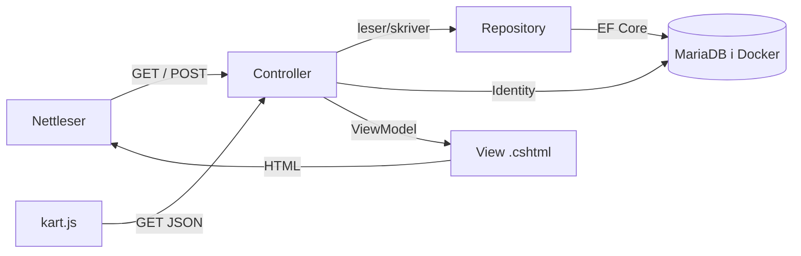

# Beredskapsportalen

En nettportal for krisesituasjoner der **offentlige aktører** (Heimevernet, kommuner) melder inn behov, og **private aktører** (bedrifter, entreprenører, privatpersoner) tilbyr ressurser som aggregater, drivstoff og transport. Behov og ressurser vises på et kart, slik at det blir lett å se hvor hjelpen trengs og hva som finnes i nærheten.

Prosjektet er laget som gruppeoppgave i IS-200 (Oppgave 1 og Oppgave 2) og er en **ASP.NET Core MVC-applikasjon som kjøres sammen med en MariaDB-database i Docker**.

## Gruppemedlemmer

- Thilo Moi
- Tobias K. Lindkvist
- Christian Urdal Hansen
- Ludvig Jensen
- Pelle Kvandal
- Emil Lund Storebaug

---

## Hurtigstart

**Krever:** [Docker Desktop](https://www.docker.com/products/docker-desktop/)

```bash
git clone https://github.com/thilomoi05/Prosjekt_host_1.git
cd Prosjekt_host_1
cp .env.example .env      # Windows (PowerShell): copy .env.example .env
docker compose up --build
```

**Før `docker compose up`:** åpne `.env` og fyll inn de tre verdiene. Ellers lages ingen testbrukere, og du kan ikke logge inn:

```
DB_ROOT_PASSWORD=et-langt-passord-minst-16-tegn
DB_PASSWORD=et-annet-langt-passord-minst-16-tegn
DB_PORT=3306
TESTBRUKER_PASSORD=Beredt2026
```

Er port 3306 opptatt (feilmelding om `3306` ved oppstart), sett `DB_PORT=3307`. Mer om `.env` og feilsøking: [docs/drift.md](docs/drift.md).

Åpne **http://localhost:8080** og logg inn med en av testbrukerne:

| Brukernavn | Passord | Rolle | Hva du ser |
|---|---|---|---|
| `test` | `Beredt2026` | Offentlig aktør (f.eks. Heimevernet) | Oversikt, kart, behov, ressurser og hva som trengs |
| `privat` | `Beredt2026` | Privat aktør (bedrift eller privatperson) | Egne ressurser, tilby ressurs og hva som trengs |
| `admin` | `Beredt2026` | Administrator (har også rollen offentlig aktør) | Alt en offentlig aktør ser, pluss adminsiden for godkjenning og tildeling |

Passordet kommer fra `TESTBRUKER_PASSORD` i `.env`, og testbrukerne lages første gang appen starter. Se [Testbrukere i docs/drift.md](docs/drift.md#testbrukere).

Mer om kjøring, begrensninger og feilsøking: **[docs/drift.md](docs/drift.md)**

---

## Funksjoner

Tre roller, med tilgang sjekket på serveren (`[Authorize(Roles = ...)]`):

| Rolle | Kan |
|---|---|
| **Offentlig aktør** (kommune, sykehus, Heimevernet) | Melde behov med type, prioritet og plassering · se alle behov med filter · se kart med behov og ressurser · finne og forespørre ressurser til egne behov · **endre** og trekke tilbake egne behov |
| **Privat aktør** (bedrift, privatperson) | Tilby ressurser med bilder · se status på egne ressurser (venter, godkjent, avvist, tildelt) · **endre** og trekke tilbake egne ressurser · se «Hva trengs» uten å se hvem som har meldt |
| **Admin** | Godkjenne eller avvise ressurser og offentlige aktører · tildele ressurser til behov med forslag sortert på avstand · godkjenne eller avslå forespørsler · fjerne tildelinger · endre alle behov og ressurser |

I tillegg:

- **Registrering og innlogging** med ASP.NET Core Identity. Offentlige aktører må godkjennes av admin før de kan logge inn.
- **Kart** (Leaflet + Kartverket) med egne ikoner per type og farge per prioritet. Skjemaene har en posisjonsvelger: klikk i kartet eller søk opp en adresse.
- **Oversikt** over ressurser og behov: dashbord, liste med filter under kartet, detaljsider og oversikt over tildelinger.
- **Historikk:** alt som skjer med et behov eller en ressurs (sendt inn, godkjent, endret, tildelt, trukket tilbake) lagres og vises på detaljsiden.
- **Mobiltilpasset:** responsivt design med Bootstrap og egne `@media`-regler.

## Teknologi

| Område | Teknologi |
|---|---|
| Rammeverk | ASP.NET Core MVC, .NET 10 |
| Innlogging | ASP.NET Core Identity (passord-hash med PBKDF2 og salt, roller, utestenging) |
| Datalagring | MariaDB 11.4 med Entity Framework Core 10 (Microting.EntityFrameworkCore.MySql) og migrations |
| Kart | [Leaflet](https://leafletjs.com/) med kartfliser fra Kartverket |
| Adressesøk | Geonorge sitt adresse-API (`ws.geonorge.no/adresser/v1`) |
| Testing | xUnit og NSubstitute |
| Drift | Docker Compose (to containere: `web` og `db`) |

---

## Arkitektur

Applikasjonen følger **MVC-mønsteret** (Model–View–Controller), med et eget **repository-lag** for datalagring. Controllerne kjenner bare repository-grensesnittene, derfor ble MariaDB lagt til uten å endre dem. 



Full beskrivelse av lagene, innlogging, kartet og alle endepunkter: **[docs/arkitektur.md](docs/arkitektur.md)**

### Prosjektstruktur

```
├── Controllers/        Home, Konto, Oversikt, Behov, Ressurs, Kart, HvaTrengs, Tildeling, Foresporsel, Admin
├── Data/               BeredskapsDbContext, oppstart av database og testbrukere
├── Migrations/         Tabellene i MariaDB, laget med EF Core migrations
├── Models/             Behov, Ressurs, Bruker, Tildeling, Foresporsel, Hendelse, Roller, Enums
│   └── ViewModeller/   Skjemamodeller med validering
├── Services/           Repository-grensesnitt, EF- og minnebaserte repositories, TildelingTjeneste
├── Sikkerhet/          Sikkerhetsheadere og norske feilmeldinger fra Identity
├── Views/              Én mappe per controller + Shared/_Layout
├── wwwroot/            CSS og JavaScript (kart, posisjonsvelger, skjemaer, filter)
├── Beredskapsportal.Tests/   Automatiske tester (xUnit)
├── docs/               drift.md, arkitektur.md, ki-bruk.md
├── docker-compose.yml  App og database
├── Dockerfile
└── Program.cs          Oppstart, DI, Identity, sikkerhet og ruting
```

### Sider og endepunkter

| Metode | Adresse | Beskrivelse | Tilgang |
|---|---|---|---|
| GET | `/` | Forside | Alle |
| GET / POST | `/Konto/Registrer` | Registrere bruker (offentlig eller privat aktør) | Alle |
| GET / POST | `/Konto/LoggInn` | Logge inn | Alle |
| POST | `/Konto/LoggUt` | Logge ut | Innlogget |
| GET | `/Konto/Profil` | Min side | Innlogget |
| GET | `/Oversikt` | Dashbord | Innlogget |
| GET | `/HvaTrengs` | Hva som trengs, uten hvem som har meldt | Innlogget |
| GET | `/Behov` | Alle behov med filter | Offentlig aktør |
| GET / POST | `/Behov/Registrer` | Melde behov | Offentlig aktør |
| GET | `/Behov/Detaljer/{id}` | Detaljside med historikk | Offentlig aktør |
| GET / POST | `/Behov/Rediger/{id}` | Endre behov | Den som meldte det, og admin |
| GET / POST | `/Behov/TrekkTilbake/{id}` | Trekke tilbake eget behov | Den som meldte det, og admin |
| GET / POST | `/Ressurs/Registrer` | Tilby ressurs med bilder | Innlogget |
| GET | `/Ressurs/Detaljer/{id}` | Detaljside med bilder, kart og historikk | Eier, admin, eller offentlig aktør når godkjent |
| GET / POST | `/Ressurs/Rediger/{id}` | Endre ressurs | Eier og admin |
| GET / POST | `/Ressurs/TrekkTilbake/{id}` | Trekke tilbake (slette) ressurs | Eier og admin |
| GET | `/Ressurs/Bilde/{id}` | Bilde av ressurs | Samme som detaljsiden |
| GET | `/Kart` | Kart med liste og filter | Offentlig aktør |
| GET | `/Kart/Behov`, `/Kart/Ressurser` | Punkter som JSON til kartet | Offentlig aktør |
| GET | `/Foresporsel/FinnRessurs/{id}` | Forslag til ressurser for eget behov | Offentlig aktør |
| POST | `/Foresporsel/Foresporr` | Forespørre en ressurs | Offentlig aktør |
| GET | `/Tildeling` | Alle tildelinger med filter | Offentlig aktør |
| GET | `/Admin` | Godkjenning av ressurser, brukere og forespørsler | Admin |
| GET / POST | `/Admin/Tildel/{id}` | Tildele ressurser til et behov | Admin |
| POST | `/Admin/GodkjennRessurs`, `AvvisRessurs`, `GodkjennBruker`, `AvvisBruker`, `GodkjennForesporsel`, `AvslaForesporsel`, `FjernTildeling` | Handlinger på adminsiden | Admin |

**Flyt i et skjema (eksempel):** `GET /Behov/Registrer` viser skjemaet → brukeren sender det inn med `POST` → controlleren validerer og lagrer i MariaDB via repository → brukeren sendes videre til `/Behov`, der det nye behovet vises.

---

## Krav i Oppgave 1

| # | Krav | Hvor | Status |
|---|---|---|---|
| – | Kjøres i Docker | `Dockerfile`, [docs/drift.md](docs/drift.md) | Ferdig |
| 1 | Controller, view-modell og view | `Controllers/`, `Models/ViewModeller/`, `Views/` | Ferdig |
| 2 | Responsive sider med dynamisk innhold fra webserver | Razor-views, `site.css`, kartdata som JSON | Ferdig |
| 3 | Håndterer GET og POST | Se tabellen over endepunkter | Ferdig |
| 4 | Skjema, og data vises på en annen side | Behov: `/Behov/Registrer` → `/Behov` og `/Oversikt` | Ferdig |
| 5 | Kart, og data fra kartet vises på en annen side | Posisjonsvelger i skjemaene → punkter på `/Kart` | Ferdig |
| 6 | Dokumentasjon om drift, arkitektur og testing | [docs/drift.md](docs/drift.md), arkitektur og [testing](#testing) i denne README | Ferdig |
| 7 | Dokumentasjon i koden | Norske kommentarer og XML-summaries i koden | Ferdig |
| 8 | Bruk av KI | Se under | Ferdig |

## Krav i Oppgave 2

| # | Krav | Hvor i koden / dokumentasjonen | Status |
|---|---|---|---|
| 1 | Kobling mot MariaDB, app og database i Docker | `docker-compose.yml`, `Data/BeredskapsDbContext.cs`, `Migrations/`, `Services/Ef*Repository.cs`, [docs/drift.md](docs/drift.md) | Ferdig |
| 2 | Registrering av ny bruker, lagret i databasen | `Controllers/KontoController.cs`, `Models/Bruker.cs` (tabellen `AspNetUsers`) | Ferdig |
| 3 | Autentisering, autorisering, og legge til, endre og slette ressurs | `KontoController`, `[Authorize(Roles)]` på controllerne, `RessursController` (`Registrer`, `Rediger`, `TrekkTilbake`) | Ferdig |
| 4 | Funksjoner som beskrevet av oppdragsgiveren | [Funksjoner](#funksjoner), `Services/TildelingTjeneste.cs`, [docs/arkitektur.md](docs/arkitektur.md) avsnitt 1 og 5b | Ferdig |
| 5 | Kartet i skjemaet setter et punkt | `wwwroot/js/posisjonsvelger.js`, `Views/Behov/Registrer.cshtml`, `Views/Ressurs/Registrer.cshtml` | Ferdig |
| 6 | Mobiltilpasset frontend | `wwwroot/css/site.css` (`@media`), `_Layout.cshtml`, [mobiltest](#mobiltest) | Ferdig |
| 7 | Enkel oversikt over ressurser | `/Oversikt`, lista under kartet, `/Ressurs/Detaljer`, `/Tildeling` | Ferdig |
| 8 | Sikkerhetstiltak | `Program.cs`, `Sikkerhet/SikkerhetsheadereMiddleware.cs`, [docs/arkitektur.md](docs/arkitektur.md) avsnitt 6 | Ferdig |
| 9 | Testing (enhet, system, sikkerhet, brukervennlighet) | `Beredskapsportal.Tests/` (137 tester), [Testing](#testing) | Enhet, system, sikkerhet og mobil ferdig. Brukervennlighetstest gjenstår |
| 10 | Dokumentasjon om drift, arkitektur og testing | [docs/drift.md](docs/drift.md), [docs/arkitektur.md](docs/arkitektur.md), [Testing](#testing) | Ferdig |
| 11 | Dokumentasjon i koden | `/// <summary>` på alle klasser, norske kommentarer i C#, Razor (`@* *@`) og JavaScript | Ferdig |
| 12 | Bruk av KI | [Bruk av KI](#bruk-av-ki), [docs/ki-bruk.md](docs/ki-bruk.md) | Ferdig |

### Endret etter tilbakemelding på innlevering 1

| Tilbakemelding | Hva vi har gjort |
|---|---|
| Legg inn konkrete prompter i KI-delen | Lagt til flere prompter vi faktisk har brukt, se [Bruk av KI](#bruk-av-ki) og [docs/ki-bruk.md](docs/ki-bruk.md) |
| Mangler automatiske tester for POST-håndtering av behov og ressurser | Nye tester i `BehovControllerTester.cs` og `RessursControllerTester.cs`: gyldig skjema lagres, ugyldig skjema lagres ikke, manglende plassering, for mange og for store bilder |
| Mangler tester for validering av skjemaer | Ny `ValideringTester.cs` med de ekte valideringsreglene for behov, ressurs, innlogging og registrering (påkrevde felt, telefon, e-post, maks lengde) |
| Mangler tester for `/Kart/Behov` og `/Kart/Ressurser` | Ny `KartControllerTester.cs`: riktige felt i JSON-svaret, bare godkjente ressurser, tildelte ressurser merket, bare GET og bare offentlige aktører |
| Rate limiting, f.eks. ved innlogging | Maks 10 forsøk per minutt per IP på innlogging og registrering (`Sikkerhet/Fartsgrenser.cs`), i tillegg til utestenging etter 5 feil passord |
| SQL-injeksjon | All databasetilgang går gjennom EF Core med parametere, ingen egen SQL. Testet manuelt, se [sikkerhetstesten](#sikkerhetstest) |
| Beskyttelse mot XSS | Razor-encoding, ingen `@Html.Raw`, `trygg()` i JavaScript og Content-Security-Policy uten `unsafe-inline`. Testet manuelt, se [sikkerhetstesten](#sikkerhetstest) |
| Kontroll av opplastede filer | Innholdet i filen sjekkes nå, ikke bare endelsen (`Sikkerhet/Bildesjekk.cs`), og hele skjemaet har en grense på 26 MB. Tester i `SikkerhetTester.cs` |

I tillegg fant vi at tekstfeltene i skjemaene ikke hadde maks lengde, mens kolonnene i databasen har det. For lang tekst ga en feil fra databasen. Nå har feltene `[StringLength]` med samme lengde, og brukeren får en melding.

---

## Testing

Vi har fire typer tester. Enhetstestene kjører automatisk. System-, sikkerhets- og mobiltesten er kjørt manuelt i nettleseren mot appen i Docker, med MariaDB og ekte data. Brukervennlighetstesten er gjort med personer utenfor gruppa.

| Type | Hva | Hvor |
|---|---|---|
| Enhetstesting | Automatiske xUnit-tester av controllere, tjenester, repositoryer, modeller, validering og sikkerhet | [Automatiske tester](#automatiske-tester-xunit) |
| Systemtesting | Hovedflytene fra start til slutt, med alle tre rollene | [Systemtest](#systemtest) |
| Sikkerhetstesting | Forsøk på å bryte tilgangskontroll, CSRF, XSS, SQL-injeksjon, filopplasting og innlogging | [Sikkerhetstest](#sikkerhetstest) |
| Brukervennlighetstesting | Personer utenfor gruppa løser oppgaver i appen | [Brukervennlighetstest](#brukervennlighetstest) |

✅ bestått · ⚠️ bestått med merknad · ❌ feilet

### Automatiske tester (xUnit)

Testene kjører uten Docker og uten database. De bruker de minnebaserte repositoriene (`InMemory*Repository`), og Identity erstattes med NSubstitute.

```bash
dotnet test Beredskapsportal.Tests
```

**Resultat (04.11.2026):** 137 av 137 tester bestått ✅ (77 fra før og 60 nye i Oppgave 2)

| Testfil | Hva den sjekker |
|---|---|
| `BehovControllerTester.cs` | POST av behov: gyldig skjema lagres, tomt skjema og manglende plassering avvises, tekst lagres uendret |
| `RessursControllerTester.cs` | POST av ressurs: lagres som «venter», ugyldig skjema lagres ikke, bilderegler (antall, størrelse, type, innhold), `/Ressurs/Bilde` kan ikke hente andre filer |
| `RedigerBehovTester.cs` | Endre behov: bare den som meldte det og admin, endringer lagres, status, dato og eier endres ikke, endret prioritet i historikken |
| `RedigerRessursTester.cs` | Endre ressurs: bare eier og admin, endringer lagres, ny godkjenning etter endring, nye bilder erstatter gamle, historikk |
| `ValideringTester.cs` | Valideringsreglene i skjemaene for behov, ressurs, innlogging og registrering (påkrevde felt, telefon, e-post, maks lengde) |
| `KartControllerTester.cs` | `/Kart/Behov` og `/Kart/Ressurser`: feltene kart.js bruker, bare godkjente ressurser, tildelte merket, bare GET og bare offentlige aktører |
| `KontoControllerTester.cs` | Innlogging (riktig og feil passord, ukjent bruker, låst konto, ikke godkjent) og registrering |
| `SikkerhetTester.cs` | Sikkerhetsheadere og CSP, roller, norske feilmeldinger, rate limiting, grense på opplasting, sjekk av bildeinnhold |
| `TilgangTester.cs` | Hvilke roller controllerne krever |
| `DetaljerTester.cs` | Detaljsidene, og at private aktører bare ser sine egne ressurser |
| `TildelingTjenesteTester.cs`, `TildelingsforslagTester.cs` | Godkjenning, tildeling, forespørsler, tilbaketrekking og avstand |
| `ForesporselControllerTester.cs`, `TildelingControllerTester.cs`, `HvaTrengsControllerTester.cs` | Forespørsler, tildelingslista og «Hva trengs» |
| `BehovRepositoryTester.cs`, `TildelingRepositoryTester.cs`, `ModellTester.cs`, `ControllerTester.cs`, `IdentitetOppsettTester.cs` | Tellinger, eksempeldata, passordregler, forsiden og oppsett av roller og testbrukere |

`TestHjelpere.cs` og `IdentitetHjelpere.cs` inneholder erstatninger for innlogging, filsystem og Identity, så controllerne kan testes uten at appen kjører.

### Systemtest

**Dato:** 03.11.2026 · **Miljø:** Windows, Docker Desktop (app og MariaDB i Docker), Chrome · **Kode:** branchen `feature/oppgave2-endre-ressurs-og-testing` · **Testbrukere:** `test`, `privat` og `admin` (se [docs/drift.md](docs/drift.md#testbrukere))

#### Registrering og innlogging

| Scenario | Steg | Forventet | Faktisk |
|---|---|---|---|
| Registrere privat aktør | `/Konto/Registrer`, rolle privat aktør | Logges inn og sendes til Oversikt | ✅ Logget inn, navnet vises i menyen |
| Registrere offentlig aktør | `/Konto/Registrer`, rolle offentlig aktør | Kontoen lages, men må godkjennes | ✅ «Takk! Kontoen er opprettet, men må godkjennes av en administrator før du kan logge inn.» |
| Logge inn før godkjenning | Logg inn med den nye offentlige aktøren | Nektes | ✅ «Kontoen din venter på godkjenning fra en administrator.» |
| Admin godkjenner bruker | `/Admin` → «Godkjenn» | Brukeren kan logge inn og ser kartet | ✅ Logget inn, `/Kart` åpnes |
| Brukernavn opptatt | Registrer `test` | Feilmelding | ✅ «Brukernavnet «test» er allerede i bruk.» |
| Svakt passord | Passord uten tall og stor bokstav | Feilmelding | ✅ «Passordet må inneholde minst ett tall. Passordet må inneholde minst én stor bokstav.» |
| Feil passord | Riktig brukernavn, feil passord | Feilmelding | ✅ «Feil brukernavn eller passord.» |
| Tomt innloggingsskjema | Trykk «Logg inn» | Feilmelding ved begge felt | ✅ |
| Logge inn med de tre rollene | `test`, `privat`, `admin` | Sendes til Oversikt | ✅ |

#### Behov (offentlig aktør)

| Scenario | Steg | Forventet | Faktisk |
|---|---|---|---|
| Melde behov | Fyll ut `/Behov/Registrer` med punkt i kartet | Lagres, vises i `/Behov`, på kartet og på detaljsiden | ✅ Lagret i MariaDB, vises alle tre steder, historikk «Behovet ble meldt inn» |
| Tomt behovsskjema | Send uten å fylle ut | Feilmelding for hvert påkrevde felt | ✅ Type, beskrivelse, område, kontaktperson, telefon og plassering |
| For langt telefonnummer | 31 siffer | Feilmelding, ikke databasefeil | ✅ «Telefonnummeret kan være på maks 30 tegn.» |
| Kartdata | `/Kart/Behov` og `/Kart/Ressurser` | JSON med feltene kartet bruker | ✅ 13 behov og 28 godkjente ressurser, 5 merket som tildelt. 41 markører på kartet |

#### Ressurser (privat aktør og admin)

| Scenario | Steg | Forventet | Faktisk |
|---|---|---|---|
| Tilby ressurs | Fyll ut «Tilby ressurs» med et PNG-bilde | Lagres som «Venter på godkjenning» | ✅ «Takk! Ressursen er sendt inn, og blir synlig når en administrator har godkjent den.» |
| Ressurs uten bilde | Send uten bilde | Feilmelding | ✅ «Du må legge ved minst ett bilde av ressursen.» |
| Admin godkjenner ressurs | `/Admin` → godkjenn | Vises på kartet, bildet kan åpnes | ✅ |
| Endre ressurs uten nye bilder | Detaljside → «Endre ressursen», bytt type og beskrivelse, flytt punktet, lagre | Lagres, må godkjennes på nytt | ❌ → ✅ Første forsøk: nettleseren krevde nye bilder (se [Funnet under testing](#funnet-under-testing)). Etter rettingen: lagret, status «Venter på godkjenning», historikk «Ressursen ble endret og venter på ny godkjenning» |
| Endre ressurs med nytt bilde | Last opp nytt bilde | Nytt bilde erstatter det gamle | ✅ Ett bilde, det gamle gir 404 |
| Trekke tilbake ressurs | Detaljside → «Trekk tilbake» → bekreft | Ressursen og bildene slettes | ✅ Detaljsiden og bildet gir 404 |
| Data blir liggende | Bygg og start containerne på nytt (uten `-v`) | Ressursen finnes fortsatt | ✅ |

#### Docker

| Scenario | Steg | Forventet | Faktisk |
|---|---|---|---|
| Starte app og database | `docker compose up --build` | To containere starter, appen svarer på http://localhost:8080 | ⚠️ Port 3306 var reservert av Windows. Rettet med `DB_PORT` i `.env` (se [docs/drift.md](docs/drift.md)), deretter ✅ |

### Sikkerhetstest

Kjørt manuelt samme dag, med de samme brukerne. Forsøkene er gjort fra nettleseren med `fetch`, slik en angriper ville gjort, i tillegg til vanlige klikk.

| Angrep / kontroll | Hva vi gjorde | Forventet | Faktisk |
|---|---|---|---|
| Sikkerhetsheadere | Leste svaret fra `/` | CSP, X-Frame-Options, X-Content-Type-Options, Referrer-Policy, Permissions-Policy. Ingen `Server`-header | ✅ Alle på plass, `script-src 'self'` uten `unsafe-inline` |
| Uinnlogget tilgang | Åpnet `/Oversikt`, `/Kart`, `/Kart/Behov`, `/Kart/Ressurser`, `/Admin`, `/Behov`, `/Ressurs/Rediger/1` | Sendes til innlogging | ✅ Alle 7 |
| Feil rolle | Som privat aktør: `/Kart`, `/Behov`, `/Admin`, `/Kart/Ressurser`, andres ressurs og `/Ressurs/Rediger/1` | Sendes til Oversikt | ✅ Alle 6 |
| Endre andres ressurs | Annen privat bruker: GET og POST direkte til `/Ressurs/Rediger/{id}`, og åpne bildet | Nektes, ingenting endres | ✅ Nektet, ressursen uendret |
| Manipulere skjemaet | Sendte `Status=Godkjent`, `RegistrertAv=admin` og `EksisterendeBilder=../../Program.cs` med «Endre ressurs» | Ignoreres | ✅ Status fortsatt «Venter», eier uendret |
| CSRF | POST til `/Behov/Registrer` og `/Konto/LoggInn` uten anti-forgery-token | Avvises | ✅ 400 Bad Request |
| XSS | Beskrivelse med `` og `<script>` | Vises som tekst, kjøres ikke | ✅ Vist som tekst på detaljsiden, i kartlista og i JSON. Sidetittelen ble ikke endret |
| SQL-injeksjon | Beskrivelse med `'); DROP TABLE Behov; --` | Lagres som tekst | ✅ Lagret uendret, tabellen `Behov` virker som før |
| Falskt bilde | Tekstfil kalt `falsk.jpg`, Windows-program (`MZ`) kalt `program.png` | Avvises | ✅ ««falsk.jpg» er ikke et gyldig JPG-bilde.» og ««program.png» er ikke et gyldig PNG-bilde.» |
| Stitraversering | `/Ressurs/Bilde/..%2F..%2Fappsettings.json` | Ingen fil sendes | ✅ 404 |
| Utestenging | 5 feil passord, så riktig passord | Kontoen låses | ✅ «For mange feil forsøk. Kontoen er låst i 5 minutter.» |
| Rate limiting | 14 innloggingsforsøk på under ett minutt fra samme IP | Fra forsøk 11: 429 | ✅ Forsøk 1–10 slapp gjennom, 11–14 fikk 429 «For mange forsøk på kort tid. Vent ett minutt og prøv igjen.» Vanlige sider virket som før |

### Mobiltest

Chrome-vinduet satt til 500 px bredt (det smaleste Chrome tillater), som er under Bootstraps mobilgrense på 576 px.

| Side | Forventet | Faktisk |
|---|---|---|
| Forside | Ingen sidelengs rulling | ✅ |
| Oversikt | Kortene stables i én kolonne | ✅ |
| Kart | Kartet fyller skjermen, «Filter» og «Vis liste» kan nås | ✅ |
| Melde behov, Tilby ressurs | Skjema og kart i én kolonne | ✅ |
| Behov (liste) | Hele tabellen kan leses | ⚠️ Tabellen rulles sidelengs inne i kortet. Kolonnene «Status» og «Dato» er skjult til man ruller, og ingenting viste at det gikk an. Rettet med teksten «Sveip sidelengs for å se alle kolonnene →» over tabeller på smal skjerm |
| Detaljside for behov | Kartet under teksten | ✅ |
| Tildelinger, Hva trengs | Ingen sidelengs rulling | ✅ |

### Brukervennlighetstest

> **Ikke gjennomført ennå.** Tabellene fylles inn når testen er gjort.

**Hvordan:** 2–3 personer utenfor gruppa får en oppgave om gangen, uten hjelp. De tenker høyt mens de løser den. Vi noterer om de klarte det, hvor lang tid det tok, og hva som var vanskelig. Etterpå retter vi det som flere snublet i.

**Testpersoner:** [Fyll inn: f.eks. «Person A, 22 år, student», uten fulle navn] · **Dato:** [Fyll inn]

| # | Oppgave | Rolle | Person A | Person B | Person C |
|---|---|---|---|---|---|
| 1 | Lag en bruker som privat aktør | – | | | |
| 2 | Tilby et aggregat med bilde, og vis hvor det står | Privat aktør | | | |
| 3 | Endre beskrivelsen av ressursen du la inn | Privat aktør | | | |
| 4 | Meld et behov for nødstrøm på Lund med høy prioritet | Offentlig aktør (`test`) | | | |
| 5 | Finn alle ledige aggregater på kartet | Offentlig aktør | | | |
| 6 | Finn ut hvilke ressurser som er tildelt behovet ditt | Offentlig aktør | | | |
| 7 | Godkjenn en ressurs som venter, og tildel den til et behov | Admin | | | |

Skriv ✅ (klarte det alene), ⚠️ (klarte det med nøling) eller ❌ (klarte det ikke), og ev. tid.

| Funn | Hvor mange | Hva vi endret |
|---|---|---|
| [Fyll inn] | | |

**Tidligere tilbakemeldinger:** Etter fremføringen og sprint review endret vi blant annet lista under kartet til fullskjerm, la til filter på kartet og laget siden «Hva trengs» (commit `0d355f4`, «Rettelser etter fremføring»).

### Funnet under testing

| Feil | Hvor | Status |
|---|---|---|
| «Endre ressurs» kunne ikke lagres uten å velge nye bilder. Nettleseren viste «The Bilder av ressursen field is required.» Årsak: `List<IFormFile>` uten `?` får en skjult `[Required]` fra ASP.NET | `/Ressurs/Rediger` | Rettet: `Bilder` er nå `List<IFormFile>?`, testet på nytt ✅ |
| Port 3306 var reservert av Windows/Hyper-V, så databasen startet ikke | `docker-compose.yml` | Rettet: porten kan settes med `DB_PORT` i `.env` |
| Tekstfeltene hadde ikke maks lengde, mens kolonnene i databasen har det. For lang tekst ville gitt databasefeil | Alle skjemaer | Rettet: `[StringLength]` på feltene, testet ✅ |
| Tabellene viste ikke at de kan rulles sidelengs på mobil | `/Behov`, `/Tildeling`, `/Admin` | Rettet: tekst over tabellen på skjermer under 768 px (`site.css`) |
| Meldingen om manglende plassering ble vist to ganger (Oppgave 1) | `/Behov/Registrer`, `/Ressurs/Registrer` | Rettet i Oppgave 1, sjekket igjen i `ValideringTester` ✅ |

<details>
<summary>Systemtest fra Oppgave 1 (30.09.2026)</summary>

Kjørt før Identity, MariaDB og godkjenning. Testbruker `test` / `test`.

#### Registrere bruker og logge inn/ut

| Scenario | Steg | Forventet resultat | Faktisk resultat |
|---|---|---|---|
| Registrere ny bruker | Gå til `/Konto/Registrer`, fyll ut alle felt og trykk «Registrer» | Brukeren logges inn og sendes til Oversikt | ✅ Logget inn og sendt til Oversikt. Navnet vises øverst til høyre |
| Logge ut | Trykk på navnet øverst til høyre | Brukeren sendes til forsiden, og menyen viser «Logg inn» | ✅ Som forventet |
| Logge inn | Logg inn med testbrukeren og med den nye brukeren | Brukeren sendes til Oversikt | ✅ Som forventet for begge brukerne |

#### Feil passord og tomme felt (validering)

| Scenario | Steg | Forventet resultat | Faktisk resultat |
|---|---|---|---|
| Feil passord | Logg inn med riktig brukernavn og feil passord | Feilmelding, og brukeren blir på innloggingssiden | ✅ «Feil brukernavn eller passord.» |
| Tomt innloggingsskjema | Trykk «Logg inn» uten å fylle ut noe | Feilmelding ved hvert felt | ✅ «Du må skrive inn brukernavn.» og «Du må skrive inn passord.» |
| Tomt registreringsskjema | Trykk «Registrer» uten å fylle ut noe | Feilmelding ved hvert påkrevde felt | ✅ Feilmelding for alle fem feltene, øverst og under hvert felt |
| Ulike passord | Skriv to forskjellige passord ved registrering | Feilmelding | ✅ «Passordene er ikke like.» |
| Brukernavnet er tatt | Registrer en bruker med brukernavnet `test` | Feilmelding | ✅ «Brukernavnet er allerede i bruk.» |
| Tomt behovsskjema | Trykk «Registrer» på `/Behov/Registrer` uten å fylle ut noe | Feilmelding ved hvert påkrevde felt, også manglende posisjon | ⚠️ Alle feltene får feilmelding, men posisjonsmeldingen vises to ganger (se under) |

#### Melde behov og registrere ressurs

| Scenario | Steg | Forventet resultat | Faktisk resultat |
|---|---|---|---|
| Melde behov | Fyll ut `/Behov/Registrer`, klikk i kartet og trykk «Registrer» | Brukeren sendes til `/Behov`, og det nye behovet står øverst | ✅ Behovet står øverst i listen med dagens dato |
| Registrere ressurs med posisjon | Fyll ut `/Ressurs/Registrer` med adresse, «Finn på kartet», bekreft plasseringen, legg ved bilde og trykk «Registrer» | Ressursen vises på `/Kart` på riktig sted | ✅ Grønn markør ved riktig adresse. Boblen viser adresse, tilgangsbeskrivelse, kontaktinfo og bildet |

#### Docker

| Scenario | Steg | Forventet resultat | Faktisk resultat |
|---|---|---|---|
| Starte appen i Docker | Kjør kommandoene under [Hurtigstart](#hurtigstart) og åpne http://localhost:8080 | Appen starter, og forsiden vises | ✅ Appen starter, og alle testene over ble kjørt i Docker |

</details>

## Bruk av KI

KI er brukt som støtte gjennom hele prosjektet, fra idé til kode. Alle endringer laget med KI har gått gjennom pull request og review fra gruppemedlemmer. Mer utfyllende beskrivelse: [docs/ki-bruk.md](docs/ki-bruk.md).

### Verktøy
- **Claude (Anthropic)**, i chat og som kodeagent (Claude Code): koding, feilsøking, skissering, testing, dokumentasjon og planlegging

### Bruksområder
| Fase | Hvordan KI ble brukt |
|---|---|
| Idé og design | Oversette Figma-skissen til sider og komponenter, designutkast for layout og farger |
| Koding (Oppgave 1) | Grunnstruktur (MVC, repositories, innlogging), kartfunksjon, posisjonsvelger |
| Koding (Oppgave 2) | ASP.NET Core Identity og roller, sikkerhetsheadere, godkjenning og tildeling, detaljsider og filter, «Endre ressurs» |
| Testing | Utkast til xUnit-tester og testscenarioer for systemtest og sikkerhetstest |
| Drift | Veiledning steg for steg for Dockerfile, `docker-compose.yml` og feilsøking |
| Dokumentasjon | Utkast til `docs/drift.md`, `docs/arkitektur.md` med diagrammer, og denne README-en |
| Planlegging | Oppsett av Trello-tavle, statusoversikt over kravene i oppgaven |

### Regler for KI i repoet
[AGENT.md](AGENT.md) beskriver hvordan KI-agenter skal jobbe: aldri kode direkte i `main`, alltid egen branch og pull request, og KI merger aldri sin egen PR. Commits laget med KI er merket med `Co-Authored-By: Claude`.

### Eksempler på prompter
- *«Bygg forsiden etter Figma-skissen, med innlogging og skjema for behov og ressurser»*
- *«Ta meg gjennom Docker-oppsettet steg for steg og forklar hva som skjer underveis»*
- *«Se gjennom repoet og sett opp en Trello-tavle med oppgavene som er gjort og det som gjenstår»*
- *«Gå i git-repoet og gi inspirasjon med figurer og diagrammer for hvordan arkitekturen er og hva vi skal gjøre videre. Vis hvordan jeg kan sette opp diagrammer i markdown-filer»*
- *«Her er Oppgave 2 og statusoversikten vår. Oppdater repoet, lag det som mangler (endre ressurs), kjør testene og oppdater README»*

---

## Arbeidsflyt

- Én branch per oppgave: `feature/kort-beskrivelse` eller `fix/kort-beskrivelse`
- All kode inn via pull request, godkjent av andre gruppemedlemmer
- Branches slettes etter merge
- Oppgaver følges opp i Trello: Backlogg → Klar til start → Pågår → Til review → Ferdig

## Kjente begrensninger

- Appen kjører over http, ikke https, i Docker. Den lytter bare på `127.0.0.1`, så den er ikke tilgjengelig fra andre maskiner.
- Hver utvikler har sin egen lokale database. Det finnes ingen felles server.
- Det er ikke satt opp automatisk backup av databasen. Data ligger i Docker-volumet `dbdata`.
- Kartfliser og adressesøk hentes fra Kartverket, så kartet krever internett.
- Se [docs/drift.md](docs/drift.md) for detaljer.
