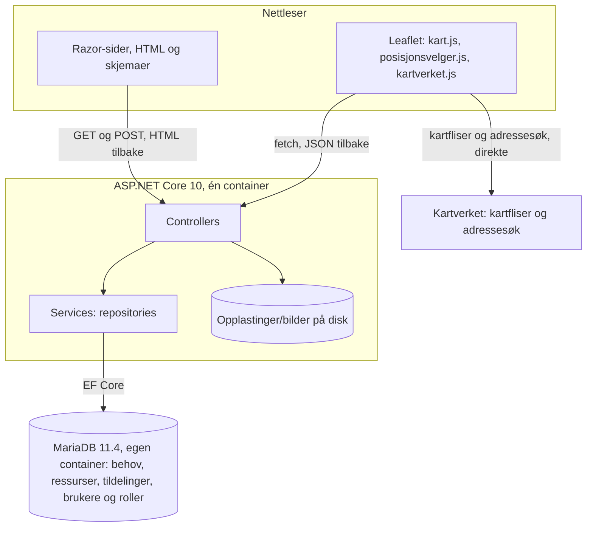
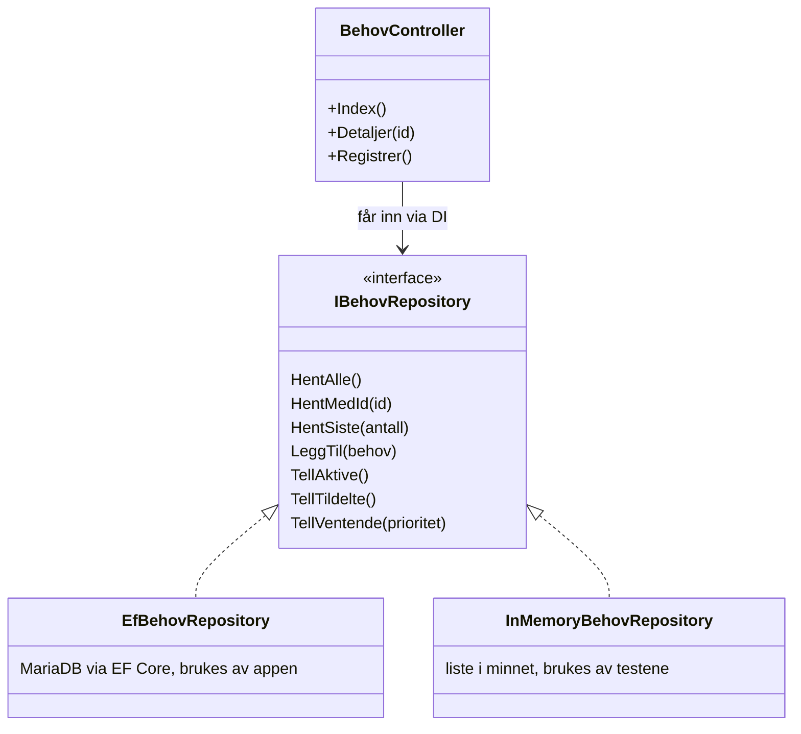
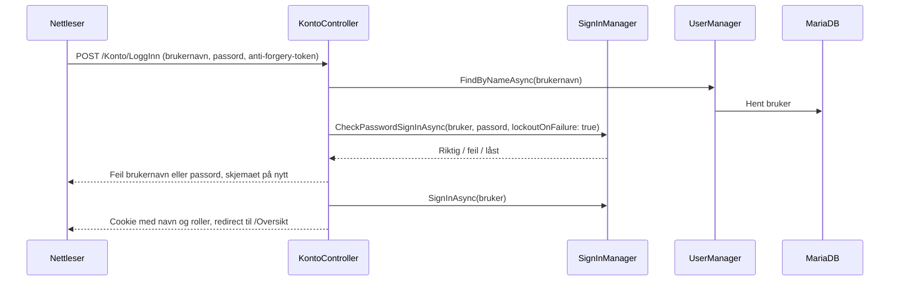
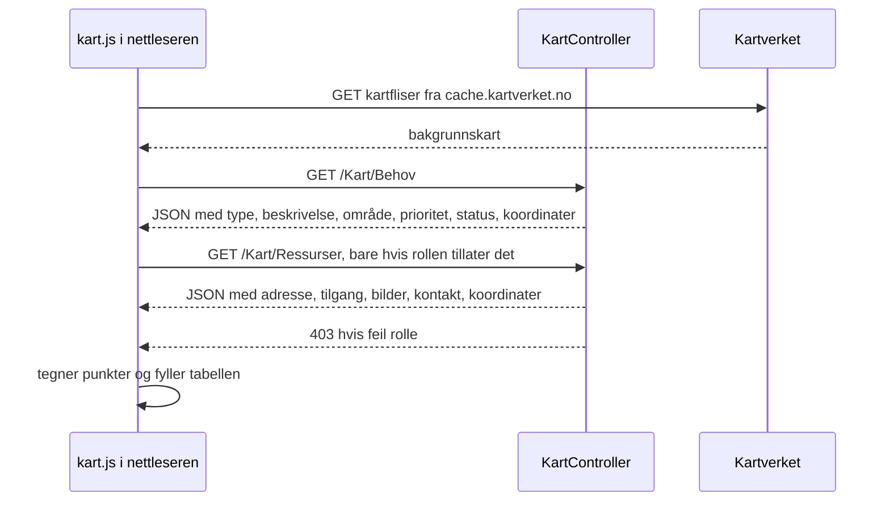
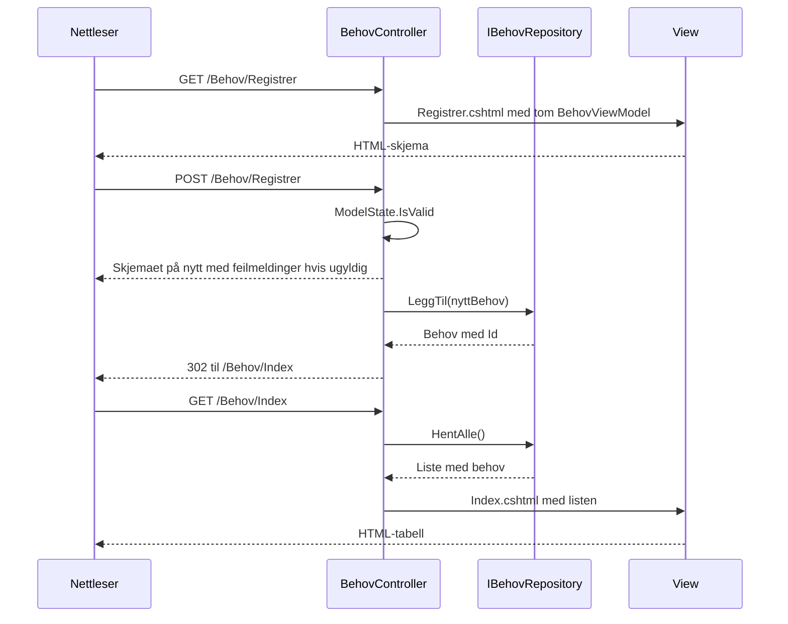
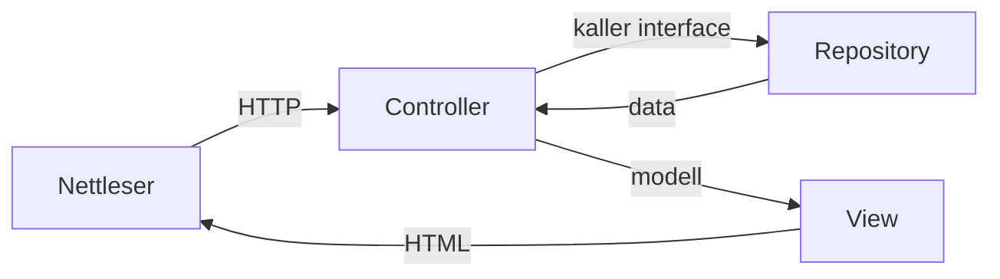

# Arkitektur

Denne siden forklarer hvordan BeredskapsPortalen er bygget opp. Den er skrevet for en som ikke kjenner prosjektet fra før. Alt som står her stemmer med koden per 02.11.2026 (branchen `feature/Identitetshandteringogwebsikkerhet`, som bygger på `main`).

Se [drift.md](drift.md) for hvordan du starter appen.

## 1. Hva portalen er

BeredskapsPortalen samler behov og ressurser under en krise, i vårt scenario et cyberangrep mot strømnettet i Kristiansand.

- **Offentlige aktører** (kommune, sykehus, brann, politi, Heimevernet) melder inn **behov**: nødstrøm, drivstoff, samband, nødbelysning, oppvarming.
- **Private aktører** (bedrifter, entreprenører, privatpersoner) registrerer **ressurser** de kan stille med: aggregat, drivstoff, UPS, transport, kommunikasjonsutstyr.
- Alt vises på et **kart** over regionen, slik at behov og ressurser kan kobles.

Rollene står i `Models/Roller.cs`: `OffentligAktor`, `PrivatAktor` og `Admin`. Ved registrering kan man bare velge de to første (`BrukerRolle`). Offentlige aktører må godkjennes av en administrator før de kan logge inn. Admin har også rollen `OffentligAktor`.

Hvem som ser hva:

| Data | Uinnlogget | `PrivatAktor` | `OffentligAktor` | `Admin` |
|---|---|---|---|---|
| Forside | Ja | Ja | Ja | Ja |
| Oversikt, tilby ressurs, hva trengs | Nei | Ja | Ja | Ja |
| Behovsliste, kart | Nei | Nei | Ja | Ja |
| Ressurser på kartet, med adresse, tilgangsbeskrivelse og bilder | Nei | Nei | Ja | Ja |
| Adminsiden: godkjenne ressurser og offentlige aktører, tildele ressurser | Nei | Nei | Nei | Ja |
| Forespørre ressurser til et behov | Nei | Nei | Sine egne | Alle |
| Trekke tilbake et behov | Nei | Nei | Sine egne | Alle |
| Trekke tilbake en ressurs | Nei | Sine egne | Sine egne | Alle |

Ressurser er skjermet fordi feltet `Tilgangsbeskrivelse` kan inneholde ting som «står i garasjen, kodelås 1234».

## 2. Overordnet bilde



To ting er verdt å merke seg. Serveren vår sender aldri kartfliser videre. Nettleseren snakker direkte med Kartverket. Og all data utenom bildene ligger i MariaDB, i Docker-volumet `dbdata`, så den blir liggende når appen stoppes. Bildene ligger i volumet `opplastinger`. Se [drift.md](drift.md).

## 3. Mappestruktur

```text
Program.cs                 oppstart, DI-registrering, Identity, sikkerhet, rutetabell
Models/                    domenemodeller: Behov, Ressurs, Bruker, Enums
Models/ViewModeller/       skjemamodeller med validering
Controllers/               Home, Konto, Oversikt, HvaTrengs, Behov, Ressurs, Kart, Tildeling
Views/<Controller>/        én mappe per controller
Views/Shared/_Layout.cshtml  felles ramme: header, meny, footer
Services/                  repository-interface, EF Core- og InMemory-implementasjoner
Data/                      BeredskapsDbContext, DatabaseOppsett, IdentitetOppsett (roller og testbrukere)
Sikkerhet/                 sikkerhetsheadere, norske Identity-feilmeldinger, navn i innloggingscookien
wwwroot/js/                kart.js, kartikoner.js, kartverket.js, posisjonsvelger.js, ressursskjema.js,
                           tabellfilter.js, detaljkart.js, oversikt.js, hvatrengs.js
wwwroot/css/site.css       all egen styling
Dockerfile                 bygger og kjører appen
Migrations/                tabellene i databasen, laget med dotnet ef
docs/                      drift.md, arkitektur.md, ki-bruk.md, Identitet_og_sikkerhet.docx
```

## 4. MVC-lagene

### Models

Domenemodellene er det systemet faktisk handler om.

| Klasse | Innhold | Merk |
|---|---|---|
| `Behov` | Type, beskrivelse, område, prioritet, status, kontakt, dato, breddegrad, lengdegrad | `VisningsNavn` gir teksten som vises, samlet ett sted |
| `Ressurs` | Type, kapasitet, adresse, tilgangsbeskrivelse, bilder, tilgjengelig fra og til, kontakt, koordinater | `Bilder` er filnavn, ikke selve filene |
| `Tildeling` | Hvilken ressurs som er satt inn på hvilket behov, når og av hvem | Ett behov kan få flere ressurser |
| `Bruker` | Arver fra `IdentityUser` (brukernavn, e-post, passord-hash). I tillegg `FulltNavn` og `VenterPaGodkjenning` | Passordet lagres aldri, bare en hash (se avsnitt 6) |
| `Roller` | Rollenavnene `OffentligAktor`, `PrivatAktor` og `Admin` | Brukes i `[Authorize(Roles = ...)]` og `User.IsInRole(...)` |
| `Enums` | `Prioritet`, `BehovStatus`, `BehovType`, `RessursType`, `BrukerRolle` | Status: Venter eller Tildelt. Prioritet: Lav, Moderat eller Høy |

### ViewModeller

Skjemaene binder mot egne modeller i `Models/ViewModeller`, ikke mot domenemodellene. Grunnen er sikkerhet og validering: en bruker skal ikke kunne sende inn `Id` eller `Status` ved å legge til et felt i skjemaet.

Valideringen ligger som attributter på feltene, for eksempel:

- `[Required]` med norsk feilmelding på alle obligatoriske felt
- `[Phone]` på telefon, `[EmailAddress]` på e-post
- `[Compare]` mellom passord og bekreft passord, `[MinLength(8)]` på passord. Resten av passordreglene sjekkes av Identity
- `[Required]` på `Breddegrad` og `Lengdegrad`, som tvinger brukeren til å klikke i kartet

Controlleren sjekker `ModelState.IsValid`. Er noe feil, returneres samme view med feilmeldingene, og brukeren beholder det de har skrevet.

### Controllers

| Controller | Tilgang | Handlinger |
|---|---|---|
| `Home` | Åpen | `Index` forside, `Error` |
| `Konto` | Åpen (`Profil` krever innlogging) | `LoggInn` GET og POST, `Registrer` GET og POST, `LoggUt` POST, `Profil` |
| `Oversikt` | Innlogget | `Index` dashbord. Offentlige aktører ser nøkkeltall, behov og de fem siste tildelingene. Private ser sine egne ressurser |
| `HvaTrengs` | Innlogget | `Index` utstyr som trengs og i hvilke områder, uten hvem som har meldt |
| `Behov` | `OffentligAktor` | `Index` liste med filter, `Detaljer`, `Registrer` GET og POST |
| `Ressurs` | Innlogget | `Index` som sender videre til `Registrer`, `Registrer` GET og POST, `Detaljer` (private ser bare sine egne), `Rediger` GET og POST (eier og admin), `TrekkTilbake`, `Bilde` (offentlige aktører, eller eieren av ressursen) |
| `Kart` | `OffentligAktor` | `Index` kartside, `Behov` og `Ressurser` som JSON til kart.js |
| `Tildeling` | `OffentligAktor` | `Index` alle tildelinger med filter |
| `Foresporsel` | `OffentligAktor` (bare egne behov) | `FinnRessurs` forslag til eget behov, `Foresporr` POST |
| `Admin` | `Admin` | `Index` de fire køene, `GodkjennForesporsel`, `AvslaForesporsel`, `GodkjennRessurs`, `AvvisRessurs`, `Tildel` GET og POST, `FjernTildeling`, `GodkjennBruker`, `AvvisBruker` |

`Behov` og `Ressurs` har også `TrekkTilbake`: en «Er du sikker?»-side (GET) og selve slettingen (POST).

`Behov` har `Rediger` (GET og POST) for å endre et behov. Den som meldte behovet og admin kan endre det, samme regel som for `TrekkTilbake`. Behov trenger ikke godkjenning, så endringen gjelder med en gang. Status, dato og hvem som meldte behovet endres ikke, og endret prioritet skrives i historikken (f.eks. «prioritet moderat → høy»).

`Ressurs` har `Rediger` (GET og POST) for å endre en ressurs. Bare eieren og admin slipper til, og tilgangen sjekkes i både GET og POST. Endrer eieren en ressurs som ikke er tildelt, settes den til `Venter` og må godkjennes på nytt, så ingen kan bytte ut innholdet i en godkjent ressurs uten at admin ser det. Nye bilder erstatter de gamle, og endringen skrives i historikken.

Admin har også rollen `OffentligAktor`, så alt som står `OffentligAktor` over, gjelder også for admin.

Rutene følger standardmønsteret fra `Program.cs`: `{controller=Home}/{action=Index}/{id?}`. Adressen `/Behov/Registrer` treffer altså `BehovController.Registrer`.

Alle POST-handlinger sjekker anti-forgery-tokenet, som beskytter mot at andre nettsteder sender skjemaer på vegne av en innlogget bruker. Det gjøres for hele appen av `AutoValidateAntiforgeryTokenAttribute` i `Program.cs` (se avsnitt 6).

### Views

Én mappe per controller, pluss `Views/Shared/_Layout.cshtml` som holder header, meny og footer. Menyen viser forskjellige lenker avhengig av om brukeren er innlogget, og markerer den aktive siden.

`_Layout` har to valgfrie seksjoner, `Styles` og `Scripts`. Kartsidene bruker dem til å laste Leaflet bare der det trengs, i stedet for på hver eneste side.

## 5. Services og repository-mønsteret

Controllerne snakker aldri direkte med datalageret. De snakker med et interface.



Behov, ressurser og tildelinger følger alle dette mønsteret. Appen bruker EF Core-versjonene, som lagrer i MariaDB. InMemory-versjonene brukes av enhetstestene, og eksempeldataene deres legges inn i databasen første gang appen starter (`Data/DatabaseOppsett.cs`).

| Interface | Metoder | I appen | I testene |
|---|---|---|---|
| `IBehovRepository` | `HentAlle`, `HentMedId`, `HentSiste`, `LeggTil`, `TellAktive`, `TellTildelte`, `TellVentende` | `EfBehovRepository` | `InMemoryBehovRepository` |
| `IRessursRepository` | `HentAlle`, `HentMedId`, `LeggTil` | `EfRessursRepository` | `InMemoryRessursRepository` |
| `ITildelingRepository` | `HentAlle`, `LeggTil` | `EfTildelingRepository` | `InMemoryTildelingRepository` |

Brukerne har ikke eget repository. De håndteres av ASP.NET Core Identity (`UserManager`), se avsnitt 6.

Koblingen skjer i `Program.cs`:

```csharp
builder.Services.AddScoped<IBehovRepository, EfBehovRepository>();
builder.Services.AddScoped<IRessursRepository, EfRessursRepository>();
builder.Services.AddScoped<ITildelingRepository, EfTildelingRepository>();
```

Controlleren ber om interfacet i konstruktøren, og ASP.NET Core sin DI-container leverer den registrerte implementasjonen:

```csharp
public BehovController(IBehovRepository behovRepository, IRessursRepository ressursRepository,
    ITildelingRepository tildelingRepository)
```

**Hvorfor dette er gjort slik.** Controllerne vet ikke om dataene kommer fra MariaDB eller fra en liste i minnet. Da byttet vi til MariaDB, ble bare `Program.cs` endret. Det gjør også koden testbar: testene sender inn InMemory-versjonen, så de trenger ingen database.

Detaljer om lagringen:

- `AddScoped` betyr én databasetilkobling (`BeredskapsDbContext`) per forespørsel. Den lukkes når svaret er sendt.
- InMemory-repositoriene bruker `lock` rundt listene, siden flere tester kan bruke dem samtidig.
- Eksempeldata: 12 behov, 28 ressurser og 5 tildelinger, pluss testbrukerne `test` (offentlig aktør), `privat` (privat aktør) og `admin` (administrator). `EksempelPosisjoner` gir eksempeldataene koordinater i Kristiansand, og kan slettes når ekte data kommer.

## 5b. Godkjenning, tildeling og historikk

Alt som endrer behov og ressurser etter at de er meldt inn, ligger i `Services/TildelingTjeneste.cs`. Controllerne sjekker hvem som får gjøre noe, og tjenesten sørger for at det blir gjort riktig.

**Godkjenning av ressurser.** En ny ressurs får status `Venter` (`RessursStatus`). Den vises ikke på kartet, i tellingene eller for offentlige aktører før en administrator har godkjent den på `/Admin`. Avviser administratoren den, lagres en begrunnelse som eieren ser. Ressurser fra en administrator godkjennes med en gang.

```
Sendt inn ──► Venter ──► Godkjent ──► Tildelt (finnes i Tildelinger)
                    └──► Avvist (med begrunnelse)
```

**Tildeling.** Admin trykker «Tildel» på et behov og får forslag fra `Services/Tildelingsforslag.cs`:

- bare ressurser som er godkjent og ikke tildelt
- bare typer som passer til behovet (tabellen `PassendeTyper`, f.eks. Nødstrøm → Aggregat og UPS), med «Vis alle typer» for unntak
- nærmeste først, regnet ut i luftlinje fra koordinatene med haversine-formelen

En ressurs kan bare være tildelt ett behov om gangen. Det sjekkes i tjenesten, og databasen har en unik indeks på `RessursId` i `Tildelinger`. Et behov er `Tildelt` så lenge det har minst én ressurs, ellers `Venter`. Admin kan fjerne en tildeling, og ressursen blir ledig igjen.

**Forespørsler.** Den som meldte et behov, kan selv finne ressurser («Finn ressurs» på behovet, med de samme forslagene som Admin får) eller forespørre en ledig ressurs fra detaljsiden til ressursen. Forespørselen (`Foresporsel`) havner i en egen kø på `/Admin`. **Godkjenn** tildeler ressursen med ett klikk gjennom den samme `Tildel`-metoden, og **Avslå** lagrer en begrunnelse den som spurte ser. Når en ressurs blir tildelt, lukkes andre ventende forespørsler om den automatisk. Det samme skjer når behovet eller ressursen trekkes tilbake.

```
Offentlig aktør: Forespør ──► Venter ──► Admin: Godkjenn ──► Tildelt
                                    └──► Admin: Avslå (med begrunnelse)
```

**Mine meldte behov.** Offentlige aktører ser sine fem nyeste behov på Oversikt, med status og hvor mange forespørsler som venter på Admin. «Se alle mine behov» åpner behovslista med filteret «Meldt av: Meg» (`/Behov?meldtav=meg`). Filteret gjenbruker `tabellfilter.js` og `_Filtermeny`, som de andre kolonnene.

**Trekke tilbake.** Den som meldte et behov, kan trekke det tilbake. Ressursene som var tildelt det, blir ledige. Eieren av en ressurs kan trekke den tilbake. Var den tildelt, fjernes tildelingen, og behovet venter igjen hvis det ikke har andre ressurser. Administratorer kan trekke tilbake alt.

**Historikk.** Hver hendelse lagres i tabellen `Hendelser` med tidspunkt, hvem og hva, og vises på detaljsidene. Historikken til en ressurs sier ikke hvilket behov den ble tildelt, fordi eieren (en privat aktør) også ser den. Historikken blir liggende selv om behovet eller ressursen trekkes tilbake.

## 6. Innlogging, tilgang og sikkerhet

### Innlogging med ASP.NET Core Identity

Brukere, passord og roller håndteres av **ASP.NET Core Identity**, satt opp i `Program.cs` som i foreleserens eksempel (`espenlimi/UIA202_2026`).

- `Bruker` arver fra `IdentityUser`. Derfra kommer brukernavn, e-post og passord-hash. Vi har bare lagt til `FulltNavn` og `VenterPaGodkjenning`.
- `BeredskapsDbContext` arver fra `IdentityDbContext<Bruker>`, som lager tabellene `AspNetUsers`, `AspNetRoles`, `AspNetUserRoles` med flere.
- Passordet lagres aldri. Identity lagrer en hash laget med PBKDF2 og et tilfeldig salt.
- Passordregler: minst 8 tegn, med stor og liten bokstav og tall.
- Etter 5 feil passord på rad låses kontoen i 5 minutter.
- **Rate limiting:** hver IP-adresse får maks 10 forsøk per minutt på `POST /Konto/LoggInn` og `POST /Konto/Registrer` til sammen (`Sikkerhet/Fartsgrenser.cs`, `[EnableRateLimiting]`). Forsøk over grensen får `429 Too Many Requests` uten at passordet sjekkes. Utestengingen beskytter én konto; fartsgrensen stopper også at noen prøver ett passord mot mange brukernavn, eller lager mange kontoer.
- `KontoController` bruker `UserManager` (lage brukere, roller) og `SignInManager` (sjekke passord, lage cookie). Vi skriver ingen passordkode selv.
- `Sikkerhet/BrukerClaimsFabrikk.cs` legger det fulle navnet i cookien, så menyen kan vise det.
- `Sikkerhet/NorskeIdentityFeilmeldinger.cs` gir norske feilmeldinger.
- `Data/IdentitetOppsett.cs` lager rollene og testbrukerne ved oppstart. Passordet hentes fra `.env`, ikke fra koden.



Meldingen er den samme for ukjent brukernavn og feil passord, så innloggingen ikke avslører hvilke brukernavn som finnes. Etter innlogging sendes brukeren bare videre til en adresse på vår egen side (`Url.IsLocalUrl`).

Innloggingscookien er `HttpOnly` (JavaScript kan ikke lese den), `SameSite=Lax` og utløper etter 8 timer uten aktivitet.

### Tilgang

Tilgangen håndheves på serveren:

- `[Authorize]` på controlleren sender uinnloggede til `/Konto/LoggInn`
- `[Authorize(Roles = Roller.OffentligAktor)]` på `Behov`, `Kart` og `Tildeling`. Andre sendes til `/Oversikt`
- `Ressurs.Detaljer` og `Ressurs.Bilde` sjekker selv: offentlige aktører ser alt, private bare sine egne ressurser
- Bildene ligger utenfor `wwwroot`, i `Opplastinger/bilder`, og sendes bare gjennom `Ressurs.Bilde`. Alt i `wwwroot` kan lastes ned av hvem som helst
- Opplastede filer får et tilfeldig `Guid`-navn, maks 5 bilder à 5 MB, og bare jpg, jpeg, png eller webp
- Innholdet sjekkes også, ikke bare endelsen: `Sikkerhet/Bildesjekk.cs` leser de første bytene og sjekker at filen faktisk er et JPG-, PNG- eller WEBP-bilde. Et program som har fått navnet `bilde.jpg`, avvises. SVG er ikke tillatt, fordi det kan inneholde JavaScript
- Hele skjemaet kan være maks 26 MB (`[RequestSizeLimit]`), så store forespørsler stoppes før de leses inn
- `Path.GetFileName` på id-en hindrer at noen ber om `../../Program.cs`

Å skjule en knapp i nettleseren er ikke tilgangskontroll. Derfor gjøres sjekken begge steder: viewet skjuler lenken, og serveren nekter kallet.

### Webapplikasjonssikkerhet (OWASP)

| Angrep | Beskyttelse |
|---|---|
| CSRF | `AutoValidateAntiforgeryTokenAttribute` i `Program.cs` sjekker anti-forgery-tokenet på alle POST-forespørsler. Cookien har `SameSite=Lax` |
| XSS | Razor gjør all tekst trygg (`@`), vi bruker ikke `@Html.Raw`. JavaScript setter tekst inn med `trygg()`. Content-Security-Policy tillater bare skript fra våre egne .js-filer |
| SQL-injeksjon | All databasetilgang går gjennom EF Core, som sender verdier som parametere. Vi skriver ingen SQL selv (ingen `FromSqlRaw` eller `ExecuteSql` i koden) |
| Passordgjetting (brute force) | Rate limiting per IP på innlogging og registrering, og utestenging av kontoen etter 5 feil |
| Skadelige filer | Endelse, innhold (magiske bytes) og størrelse sjekkes. Filene lagres utenfor `wwwroot` med tilfeldig navn og sendes bare til den som har tilgang |
| For lang input | `[StringLength]` på skjemafeltene, samme lengde som kolonnene i databasen, så brukeren får en melding i stedet for en feil fra databasen |
| Clickjacking | `X-Frame-Options: DENY` og `frame-ancestors 'none'` |

`Sikkerhet/SikkerhetsheadereMiddleware.cs` legger disse headerne på alle svar:

| Header | Verdi |
|---|---|
| `Content-Security-Policy` | Bare egne filer, pluss Google Fonts, kartbilder fra `cache.kartverket.no` og adressesøk på `ws.geonorge.no` |
| `X-Frame-Options` | `DENY` |
| `X-Content-Type-Options` | `nosniff` |
| `Referrer-Policy` | `strict-origin-when-cross-origin` |
| `X-XSS-Protection` | `1; mode=block` |
| `Permissions-Policy` | Kamera, mikrofon og posisjon av |

I tillegg er headeren `Server` fjernet (`AddServerHeader = false`), og `UseHsts()` brukes utenfor utvikling. Fordi CSP forbyr skript og `style="..."` skrevet rett i HTML-en, ligger all JavaScript i `wwwroot/js` og all styling i `site.css`.

## 7. Kartet

Tre JavaScript-filer, med hver sin oppgave:

| Fil | Oppgave |
|---|---|
| `kartverket.js` | Felles oppsett: lager Leaflet-kartet og legger på bakgrunnskart fra Kartverket. Startpunkt Kristiansand sentrum, zoom 12 |
| `kart.js` | Kartsiden: henter punkter fra serveren, tegner dem, og fyller tabellen under kartet |
| `posisjonsvelger.js` | Det lille kartet i skjemaene: brukeren klikker, koordinatene havner i to skjulte felt |



Detaljer:

- Behov tegnes som runde prikker, røde for akutt og oransje for planlagt. Ressurser tegnes som firkanter. Både farge og form brukes, slik at kartet kan leses av fargeblinde
- Tabellen under kartet viser de samme punktene. Den fungerer som alternativ for skjermlesere
- All tekst fra serveren kjøres gjennom funksjonen `trygg()` før den settes inn i HTML, så en beskrivelse med `<script>` ikke kjøres hos andre brukere
- Adressesøket i ressursskjemaet kaller Kartverkets åpne API på `ws.geonorge.no/adresser/v1/sok`, og flytter markøren til første treff. Brukeren må selv bekrefte at markøren står riktig
- `Program.cs` tvinger `InvariantCulture` på hver forespørsel, slik at koordinater med punktum (58.14) leses likt på en norsk PC og i Docker-containeren

## 8. GET- og POST-flyten

Alle skjemaene følger samme mønster: GET viser skjemaet, POST tar imot, validerer, lagrer og sender videre med en redirect. Redirect etter POST gjør at en oppfriskning av siden ikke sender skjemaet på nytt.



Hvor de ulike skjemaene sender brukeren videre:

| Skjema | Ved suksess |
|---|---|
| `POST /Konto/Registrer` | Logger inn brukeren og går til `/Oversikt` |
| `POST /Konto/LoggInn` | `/Oversikt` |
| `POST /Behov/Registrer` | `/Behov/Index` |
| `POST /Ressurs/Registrer` | `/Oversikt` |
| `POST /Konto/LoggUt` | `/` |

## 9. Kort oppsummert



Controlleren tar imot, henter eller lagrer via et repository, og gir en ferdig modell til viewet. Viewet henter aldri data selv.


To ting å være klar over utover dette:

- **Kartet henter alle punkter** i ett kall. Det går fint med 40 punkter, men ikke med 4000. Filtrering på område og status bør skje på serveren.
- **Koden følger den opprinnelige casen**, der offentlige aktører melder behov og private tilbyr ressurser. Analysedokumentet vårt avgrenset løsningen til innbygger til innbygger. Enten oppdaterer vi analysen, eller så endrer vi koden. De to bør si det samme før EXPO.
